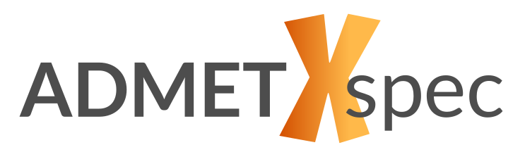

# ADMET-XSpec: A Tool for Systematic Cross-Species Data Integration in ADMET Prediction

___

<p align="center">
  
</p>

___

## What is ADMET-XSpec?
ADMET-XSpec is an open-source tool that facilitates systematic cross-species data integration for training ADMET
(Absorption, Distribution, Metabolism, Excretion, and Toxicity) prediction models. **The tool is designed to help
researchers assess and understand the translatability of ADMET parameters measured in non-human assays in the context
of human drug development.**

ADMET-XSpec implements a comprehensive workflow that includes data preprocessing, feature engineering, model training,
and evaluation. ADMET-XSpec allows for the evaluation of predictive models trained on human data augmented by non-human
data points, leveraging a selection of machine learning algorithms, feature extraction techniques and additional
data preprocessing steps. Trained models can then be used to make predictions for new molecules.
The repository is currently under active development.

## Documentation

For usage and examples of ADMET-XSpec 1.1.0, see the
[ADMET-XSpec documentation](https://admet-xspec-docs.readthedocs.io/en/latest/index.html).

## Quick start

This is an extract from the [ADMET-XSpec documentation](https://admet-xspec-docs.readthedocs.io/en/latest/quickstart.html).

ADMET-XSpec requires Python 3.11.8 and can be set up either using plain `uv` or by creating a conda environment.
First, clone the repository:

```bash
git clone https://github.com/admet-xspec/admet-xspec.git
cd admet-xspec
```

### 1. UV setup
Follow the [official uv docs](https://docs.astral.sh/uv/getting-started/installation/) to install uv.
Then, have uv create a `.venv` within the current directory and install packages from the lockfile
(uv downloads Python 3.11.8 if it is not available on your system):
```bash
uv sync
```
#### Run example with uv
```bash
uv run process.py --cfg configs/examples/train_lgbm.gin
```

### 2. Conda setup
The dependencies are declared in `pyproject.toml`, so they are installed with `uv pip` inside the conda environment:
```bash
conda create -n xspec python=3.11.8
conda activate xspec
pip install uv
uv pip install -r pyproject.toml
```
#### Run example with conda
```bash
# if you haven't already:
conda activate xspec

python -m process --cfg configs/examples/train_lgbm.gin
```

### Inference
Models trained by `process.py` can be used to make predictions for new molecules with `predict.py`:
```bash
uv run predict.py --cfg configs/examples/predict.gin
```
See the [documentation](https://admet-xspec-docs.readthedocs.io/en/latest/inference.html) for details.

### Development
Contributors should install the `pre-commit` hooks:
```bash
uvx pre-commit install
# or, inside the conda environment
pip install pre-commit && pre-commit install
```

## License

ADMET-XSpec is released under the [MIT License](LICENSE).
